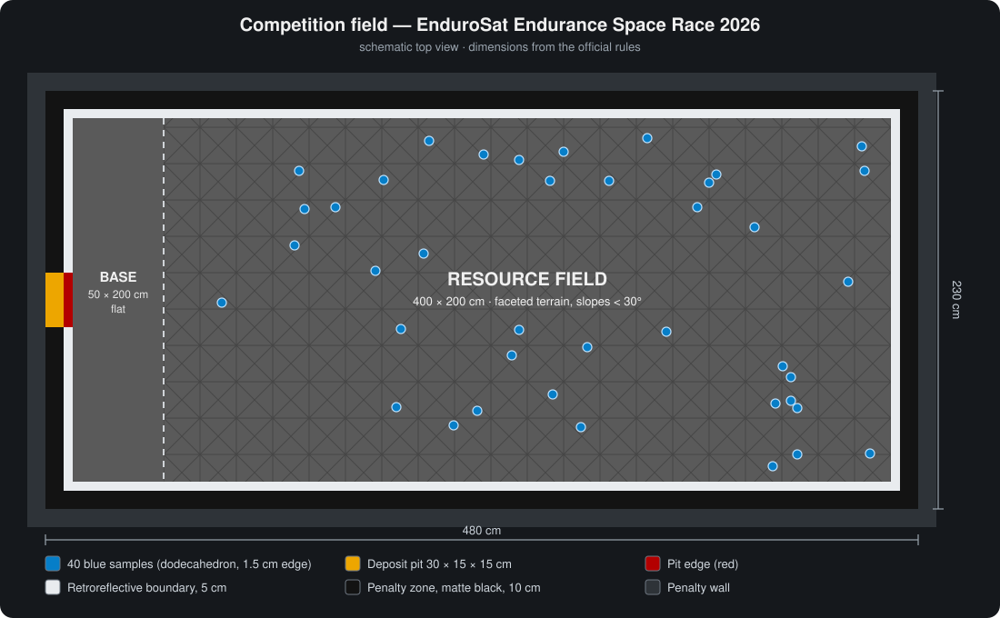
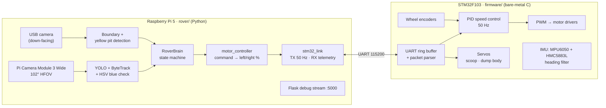
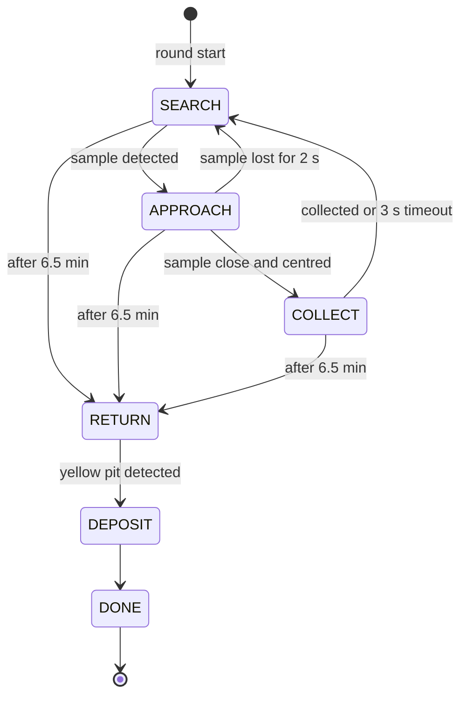

<div align="center">

# 🌙 Moonrover

**An autonomous lunar resource-collecting rover built for the
[EnduroSat Endurance Space Race 2026](https://career.fmi.uni-sofia.bg/sites/default/files/EnduroSat-Endurance-Space-Race-2026_0.pdf)**

Raspberry Pi 5 · Computer vision (YOLO + OpenCV) · STM32 real-time motor control


</div>

---

Moonrover searches a simulated lunar surface for resource samples, collects
them and delivers them to a deposit pit. It does all of this **on its own**: there
is no remote control and no communication with the rover during a run. Every
decision is made on board within an 8-minute round.

## Table of contents

- [About the project](#about-the-project)
- [The competition](#the-competition)
- [How Moonrover meets the challenge](#how-moonrover-meets-the-challenge)
- [System architecture](#system-architecture)
- [Autonomy](#autonomy)
- [Perception](#perception)
- [Embedded firmware](#embedded-firmware)
- [Pi ⇄ STM32 protocol](#pi--stm32-protocol)
- [Repository structure](#repository-structure)
- [Getting started](#getting-started)
- [Future improvements](#future-improvements)
- [Team](#team)
- [Acknowledgements](#acknowledgements)

---

## About the project

Moonrover is our team's entry in the **Endurance Space Race 2026**, a robotics
competition organised by the Sofia-based space company **EnduroSat**. The task
in the official rules is short: *"Build an autonomous lunar rover to collect and
deposit resources."*

We took it on because it is a complete space-robotics problem from end to end:

- **Perception**: find small samples on uneven grey terrain under arbitrary lighting.
- **Autonomy**: decide what to do next with no human in the loop.
- **Embedded control**: hold wheel speed on slopes of up to 30° and talk reliably to the main computer.
- **Mechanics**: pick the samples up and dump them into a pit.

All of this has to fit into a 50 cm cube, run on a battery and be judged by
EnduroSat's spacecraft hardware, software and mechanical engineers.

## The competition

| | |
|---|---|
| **Event** | EnduroSat Endurance Space Race 2026 ([official rules, PDF](https://career.fmi.uni-sofia.bg/sites/default/files/EnduroSat-Endurance-Space-Race-2026_0.pdf)) |
| **Organizer** | EnduroSat EAD, Sofia, Bulgaria |
| **Finals** | 13 July 2026, EnduroSat Space Center, Sofia |
| **Prize pool** | €17,000: 1st €10,000, 2nd €5,000, 3rd €2,000 |
| **Teams** | up to 5 members, each under 35 |
| **Vehicle** | start size ≤ 500 × 500 × 500 mm, under 25 kg, electric battery, **no communication: fully autonomous** |

### The field

<p align="center"></p>

| Element | Specification |
|---|---|
| Overall | 480 × 230 cm |
| Base field | 50 × 200 cm, flat. The rover starts here. Silicon carbide P100, grey `#5A5A5A` |
| Resource field | 400 × 200 cm, faceted terrain with slopes under 30°, steeper near the base |
| Resources | **40 regular dodecahedra**: 1.5 cm edge, 10 g, PETG, bright blue `#067EC8`. Scattered unevenly, with fewer samples near the base |
| Deposit pit | 30 × 15 × 15 cm, yellow `#EDA600`, next to the base field, with a red `#B30000` edge |
| Field boundary | 5 cm **retroreflective** tape (ORAFOL REFLEXITE) |
| Penalty zone / wall | 10 cm matte black `#131313` zone, surrounded by a 25 cm wall |

### Round rules

- The rover starts anywhere in the base field. After the organizers' **START** signal, the team starts it with a button or switch.
- **8 minutes** per round. Only resources **inside the pit** count at the end.
- The team may send an optional **STOP** to end the round early.
- **Penalty:** touching the penalty zone or wall more than 3 times, or for longer than 20 s, ends the round.
- The finals have **3 rounds**, and the team chooses which round is scored.

### Scoring

Six criteria, 1–10 points each, **60 points** in total:

| Criterion | What counts |
|---|---|
| Presentation | overall technical quality |
| Presentation | technological viability of the vehicle |
| Demonstration | number of resources collected in the best round |
| Demonstration | time used in the best round (less is better) |
| Bill of materials | `(lowest finalist price / this team's price) × 10` |
| Q&A | team knowledge and preparedness |

## How Moonrover meets the challenge

| Requirement | Our solution |
|---|---|
| Fully autonomous, no communication | Every decision is made on board by a state machine on the Raspberry Pi. The web page is a read-only debug stream used during development. |
| Find 40 small blue samples on grey terrain | A custom-trained **YOLO** model with ByteTrack tracking. Each detection is confirmed by an **HSV colour check** (enough blue pixels in the box), which rejects false positives. |
| Stay out of the penalty zone | A **down-facing camera** watches the ground ahead in left, centre and right zones and detects the bright retroreflective boundary. **AVOID** overrides every other behaviour and turns away from the side the boundary is on. |
| Deliver samples to the yellow pit | The bottom camera detects the pit by its yellow colour and triggers **DEPOSIT**. |
| 8-minute round | An on-board round timer: return to base at 6:30, hard stop at 8:00. |
| Slopes up to 30° | Closed-loop **PID speed control** on wheel encoders runs on the STM32 at 50 Hz, so speed holds uphill and downhill. |
| Safety | Two independent watchdogs. The Pi sends **stop** if its control loop stalls for more than 0.5 s, and the STM32 stops the motors if the link is silent for 300 ms. |
| Low BOM cost (scored) | Off-the-shelf electronics: Raspberry Pi 5 for vision and decisions, a low-cost STM32F103 "Blue Pill" for real-time control. |

## System architecture



The split is deliberate. The Pi does the heavy, non-deterministic work (neural
network inference at a few frames per second). The STM32 does the hard real-time
work: interrupts, PWM, PID, watchdog. A slow or stalled vision frame can never
leave the motors without control.

## Autonomy

The "brain" ([`rover/state_machine.py`](rover/state_machine.py)) is a finite-state
machine that runs once per camera frame:



| State | Behaviour |
|---|---|
| `SEARCH` | Spin in place looking for a sample. |
| `APPROACH` | Steer to keep the nearest sample centred (15 % dead band) and drive towards it. If the sample drops out of view, keep driving for up to 2 s before giving up. |
| `COLLECT` | Creep forward slowly. When the sample leaves the frame, count it as collected. |
| `RETURN` | Drive back towards the base. |
| `DEPOSIT` | Stop at the pit and dump the load. |
| `AVOID` | **Highest priority.** When the boundary is ahead, turn away from it (towards the clear side), then resume the previous task. |
| `DONE` | Stop. Any state enters it when the 8-minute round ends. |

## Perception

**Samples**: main camera, [`rover/track.py`](rover/track.py)
1. A YOLO model (custom `best.pt`) with ByteTrack tracking finds candidate boxes.
2. Detections below `CONFIDENCE_THRESHOLD` (0.5) are discarded.
3. At least 20 % of the pixels in a box must fall in the blue HSV range.
4. The **largest** remaining box is the nearest sample. It becomes the target.
5. The angle comes from the 102° field of view. The distance is a pinhole-camera estimate based on the sample's 4.2 cm circumscribed diameter ([`rover/navigation.py`](rover/navigation.py)).

Before each run, white balance and exposure are locked against a neutral sheet
([`rover/camera_setup.py`](rover/camera_setup.py)). This stops the camera's
auto white balance from washing out the blue whenever a sample fills the frame.

**Boundary**: down-facing camera. The bottom 30 % of the frame is split into
left, centre and right zones. A zone triggers when at least 5 % of its pixels are
retroreflector-bright (5× brighter than the floor median, absolute value above 150)
or lie on a very sharp brightness edge. Shadows darken the floor gradually, so
they do not trigger it.

**Deposit pit**: the same camera. The pit counts as found when at least 5 % of
the frame is yellow in HSV.

## Embedded firmware

Bare-metal C for the STM32F103 ([`firmware/`](firmware/)), using direct register
access with no HAL:

- **Clock**: 8 MHz crystal → PLL → 72 MHz.
- **UART link**: interrupt-driven RX into a 4 KB ring buffer, with resynchronising packet parser and XOR checksum.
- **Motors**: per-side PID speed control (in % of maximum wheel speed). Feedback comes from encoder interrupts, output is 24 kHz PWM with a direction pin.
- **Safety**: watchdog stops both motors if no valid packet arrives for 300 ms.
- **Servos**: 4 channels at 50 Hz (scoop, dump body, spare).
- **IMU**: MPU6050 gyro and HMC5883L magnetometer over I²C with timeouts, fused into a heading by a complementary filter.
- **Telemetry**: wheel speeds sent at 10 Hz, RLE-compressed. Battery and sonar slots are reserved and hold placeholder values for now.

| Function | Pins |
|---|---|
| UART to Pi (USART1) | PA9 TX, PA10 RX |
| Motor PWM (TIM3 CH1/CH2, 24 kHz) | PA6 left, PA7 right |
| Motor direction | PB0 left, PB1 right |
| Wheel encoders (EXTI, both edges) | PC13 left, PC14 right |
| Servos (TIM2 CH1–4, 50 Hz) | PA0, PA1, PA2, PA3 |
| IMU, I2C1 at 400 kHz | PB6 SCL, PB7 SDA |

## Pi ⇄ STM32 protocol

The link uses `/dev/serial0` on the Pi (GPIO14/15, enabled in `raspi-config`) at **115200 8N1**.

**Commands, Pi → STM32**: a fixed 7-byte frame
`0xAA CMD A1 A2 A3 CRC 0xBB`, where `CRC = CMD ^ A1 ^ A2 ^ A3`

| CMD | Meaning | Arguments |
|---|---|---|
| `0x00` | emergency stop | none |
| `0x01` | set speed | `A1` left, `A2` right: `int8`, −100…100 % of max speed |
| `0x02` | reset odometer | none |
| `0x03` | tune PID | `A1` = 1 Kp, 2 Ki or 3 Kd; `A2` integer part; `A3` fraction × 100 |
| `0x05` | servo | `A1` id 0…3, `A2` angle 0…180 |

The Pi re-sends the current speed command at 50 Hz, so the STM32 watchdog never
starves while vision is thinking.

**Telemetry, STM32 → Pi**: 10 Hz
`0xCC LEN RLE[LEN] CRC 0xDD`, where `RLE` is a list of `[value, count]` pairs and
`CRC = LEN ^ (all RLE bytes)`. The unpacked 10-byte payload is:
`status · battery (V×10) · left speed (int8 %) · right speed (int8 %) · sonar (cm) · 5 reserved`.

## Repository structure

```
moolrover/
├── rover/                    # Raspberry Pi: vision, autonomy, link (run from this folder)
│   ├── track.py              #   entry point: control loop + debug web stream
│   ├── state_machine.py      #   RoverBrain finite-state machine
│   ├── navigation.py         #   target choice, confidence filter, angle and distance
│   ├── motor_controller.py   #   brain command → (left, right) speed in %
│   ├── stm32_link.py         #   UART protocol + background TX/RX threads
│   └── camera_setup.py       #   white-balance lock, blue-colour check
├── firmware/                 # STM32F103 bare-metal firmware
│   ├── main.c                #   parser, PID, motors, encoders, servos, IMU, telemetry
│   ├── rcc.c                 #   72 MHz clock setup
│   ├── startup.c             #   vector table, Reset_Handler
│   ├── linker_script.ld
│   └── Makefile
├── docs/field.svg            # competition field diagram
└── requirements.txt
```

## Getting started

### Hardware

- Raspberry Pi 5 with Camera Module 3 Wide (forward-facing) and a USB camera (down-facing)
- STM32F103C8 "Blue Pill", wired to the Pi's UART (GPIO14/15)
- Differential drive: 2 DC motors with encoders and a DIR + PWM motor driver
- MPU6050 + HMC5883L IMU, servos for the scoop and the dump body, battery

### Raspberry Pi

```bash
sudo apt install python3-picamera2            # picamera2 comes from apt, not pip
python3 -m venv --system-site-packages venv
venv/bin/pip install -r requirements.txt

# put the YOLO weights (best.pt) into rover/
cd rover
../venv/bin/python track.py
```

During start-up, point the main camera at a white or grey sheet so the white
balance locks correctly. The round timer starts as soon as the program is running.

For debugging, open `http://<pi-ip>:5000/`:

| Page | Purpose |
|---|---|
| `/video` | main camera with detections, state, target angle and distance, telemetry |
| `/boundary` | bottom camera with boundary zones and yellow detection |
| `/calibrate` | re-lock the white balance |
| `/restart` | restart the round |

### Firmware

You need [`arm-none-eabi-gcc`](https://developer.arm.com/downloads/-/arm-gnu-toolchain-downloads)
and the CMSIS headers ([core](https://github.com/STMicroelectronics/STM32CubeF1/tree/master/Drivers/CMSIS/Core/Include),
[device](https://github.com/STMicroelectronics/cmsis_device_f1)). Header paths are
set at the top of the `Makefile`, or override them on the command line:

```bash
cd firmware
make                                   # or: make INC_CORE=... INC_DEV=...
st-flash write firmware.bin 0x08000000
```

### Calibration on the real rover

| Parameter | File | How to tune |
|---|---|---|
| `MAX_WHEEL_SPEED_MPS` | `firmware/main.c` | Measure the wheel speed at 100 % PWM. The PID works in % of this value. |
| `BOUNDARY_CAM_INDEX` | `rover/track.py` | Find the USB camera's `/dev/videoN` with `v4l2-ctl --list-devices`. |
| `CONFIDENCE_THRESHOLD` | `rover/navigation.py` | Lower it if real samples are ignored. |
| `BLUE_LOWER/UPPER`, `BLUE_MIN_FRACTION` | `camera_setup.py`, `track.py` | Watch the `blue:` value on `/video`. |
| Boundary thresholds | `rover/track.py` | Watch the `L/C/R` values on `/boundary`. |
| Drive speeds | `rover/motor_controller.py` | Speeds in % for each command. |

### Testing without hardware

```bash
python3 rover/stm32_link.py --selftest   # protocol packing, CRC, RLE, telemetry parsing
```

## Future improvements

- [ ] **Physical START button.** The rules require a button or switch to start the round after the organizers' signal. Today the round starts when the program launches.
- [ ] Heading-controlled `RETURN`: send the IMU heading to the Pi and steer back to the base.
- [ ] Dump servo sequence in `DEPOSIT`, using `link.set_servo(...)`.
- [ ] Real battery voltage (ADC) and sonar distance in the telemetry; both are placeholders now.
- [ ] Use the early **STOP** once the load is delivered, to improve the time score.
- [ ] Quadrature encoders, so direction is measured rather than taken from the direction pin.
- [ ] Unit tests for the state machine and vision functions.

## Team

Built by a student team for the EnduroSat Endurance Space Race 2026.

<!-- TODO: add team members and roles, e.g.
| Name | Role |
|---|---|
| ... | Computer vision & autonomy |
| ... | Embedded firmware |
| ... | Mechanical design |
-->

## Acknowledgements

- [EnduroSat](https://www.endurosat.com/) for organising the Endurance Space Race and designing the challenge.
- [Ultralytics YOLO](https://github.com/ultralytics/ultralytics), [OpenCV](https://opencv.org/) and [Picamera2](https://github.com/raspberrypi/picamera2).
